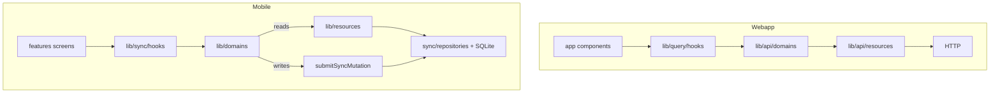

# Mobile `lib/` data layers

Mobile tier-1 CRM data is **local-first** (SQLite + sync outbox). Tier-2/3 use HTTP via `lib/api/`.

## Layer map (webapp ↔ mobile)

| Webapp | Mobile | Responsibility |
|--------|--------|----------------|
| `lib/api/resources/*` | `lib/resources/*` | List params, row mappers, SQL fragments — **no React, no I/O** |
| `lib/api/domains/*` | `lib/domains/*` | Public CRUD API (web: `async` + HTTP; mobile: **sync** + `submitSyncMutation`) |
| `lib/query/hooks/*` | `lib/sync/hooks/*` | Named UI hooks backed by the SQLite Query view cache |
| `clientApiJson` / `serverApiJson` | `lib/api/client.ts`, `online-only.ts` | Tier-2/3 REST only |
| — | `lib/sync/*` | Pull, outbox, materializers (mobile-only) |
| — | `lib/sync/repositories/*` | Thin SQLite execution (imports `lib/resources`) |



**Invalidation:** SQLite remains the tier-1 source of truth. Mobile reruns active matching SQLite
views and stores their snapshots in TanStack Query after each local write or materialized pull.
Inactive matching views are removed so their next observer rereads SQLite synchronously. Features
use named sync hooks and never access QueryClient.

## Import policy

| From `features/**` | Allowed |
|--------------------|---------|
| `lib/sync/hooks/*` | Tier-1 **reads** (including imperative `readContactsList` for paginated lists) |
| `lib/domains/*` | Tier-1 **writes** (`createContact`, `updateContact`, …) |
| `lib/api/*` | Tier-2/3 only (settings, photos, geocode, share) |
| `lib/sync/repositories/*` | **Never** — use domains or hooks |

## Adding a tier-1 entity

1. API domain + `emitSyncBatch` (see [sync-architecture.md](../../../.agents/skills/bondery-api/references/sync-architecture.md))
2. Mobile materializer + optimistic writer
3. `lib/resources/<entity>.ts` — mappers and query builders
4. `lib/sync/repositories/<entity>.ts` — `db.getAllSync` / `db.run`
5. `lib/domains/<entity>.ts` — named exports aligned with webapp `lib/api/domains/*`
6. `lib/sync/hooks/*` — `useSyncQuery` wrappers for screens

## Sheet submit lifecycle (tier-1 CRM)

Bottom sheets must not `await` sync push/pull. Domain handlers stay **synchronous** (`lib/domains/*` → `submitSyncMutation`).

| Hook | Use when |
|------|----------|
| `useSheetLocalSubmit` | RHF form; `perform(values)` writes locally |
| `useSheetLocalAction` | Confirm/delete or non-RHF actions |
| `useSheetNetworkSubmit` | Tier-2 HTTP (share email, settings) |

Contract: `perform` → `onClose` → `onSuccess`. Expose `{ isSubmitting, submit }` to `Sheet` actions. Parent sections pass `onPersist` / sync callbacks only — no parent `isSubmitting` for channel edit sheets.

## Regression checks

```bash
pnpm run check:types -w mobile
pnpm run check-sync-patterns -w mobile
```
